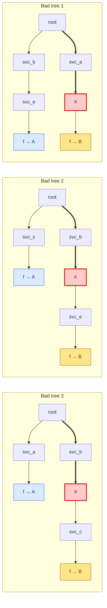

<h1 align="center">Finding Where to Look</h1> 
<em>Localizing state corruption from many bad call trees</em>

I'd like to describe a debugging technique I stumbled upon while dealing with some of the hardest bugs I've had to help debug. It's not enough to solve the bug or find a root cause,
but it can be very helpful when the possible causes are spread across a large unfamiliar codebase. And it can help suggest causes even when the actual logs we're looking at will
never have a smoking gun and look completely fine when looked at individually.

I doubt it's original, and possibly related work is in the Appendix, but I came up with this independently and have found it useful.

## The setting

This came up when we were looking at A/B tests on a function that was pretty deep in a call tree. Each call tree would call the function several times across different paths;
but the call tree itself was a single interaction. We expected it to be entirely in A or entirely in B. But we found there were some experiments where up to 10% of the
trees had some of the function calls showing A, and the other calls showing B. This is obviously pretty bad, because 10% of the data isn't usable; but it also meant it was hard
to trust the trees that were all A or all B.

## Our first attempts

We had access to a bunch of these call trees, and each function call had a bunch of metadata attached. The first thing to do was to look at some example trees. Our hope was that
something was corrupting one of the nodes in the tree and we'd be able to see that all of the downstream nodes were messed up. These trees all had
pretty different shapes, and other than the one bad property we couldn't find any corruption of metadata. It didn't look like any of the nodes were misbehaving.

The next step was to look at the function (the function was in a codebase unfamiliar to our team, so we left looking at it until second). Similarly nothing seemed wrong, and it seemed
like there were many instances of the function being called without any problems.

## Generalizing the problem

Before we continue I want to present what I think of as the general case for this problem. We have a tree of functions. Each node is a function that takes in some state.

`g(state)` produces `state_0, ..., state_n` which are states to pass down to each of its `n` children and optionally one more output representing the state at that node.
The tree has several kinds of functions `f(state), g(state), h(state)`, etc. There is one particular function `f` that is called several times in the tree and outputs some
state of its own which should always be the same. In the example above, the state of this `f` is the experiment arm. We want it to be all A or all B. But we have a collection
of examples where this is not the case, and we want to figure out why.

One technical point, in programming the functions are naturally mapped to either coding function or services that call each other. We want the edges of the dag to represent
causality, so if we had a function `foo` call a function `bar` that would have side effects and return control to `foo`, in our trees this is represented as `foo_1 -> bar -> foo_2`.

## Finding Where to Look

In the particular cases of my experiments, the functions were RPC calls and the trees were RPC trees. The state at each node was a log written by that service. The log contained
fairly coarse metadata, nothing that actually pointed to anything going wrong.

However, we had a lot of these trees that had different structures but the same problem. Suppose that we know there is only a single function that is the cause of the problem and that
there is only one path to that function. Then if we looked at all the trees, we know that each tree has to contain at least one instance of the path, and one of the paths that end up
at A or at B must have this path in their ancestry. So if we were to count the number of path segments from the root to A or B (and not allowing duplicate paths from the same tree) then
we know the function is on a path that occurs exactly as often as the number of examples we have. Recall that we had a wide variance in the kinds of trees so most paths would occur less often.

Of course, in practice one bad node and only one path to it aren't very likely. But that's fine, if we have `k` paths to the bad node, then by pigeonhole one of these must occur in at
least `1/k` trees. And we can see that this is true even if there's multiple nodes that mess up the state. We just have `k` be the total number of paths to any of these.

This suggests a natural algorithm - count the number of paths that end up at A or B, order them by size and use that to guide your search.

If we're constructing examples adversarially it's easy to find ones for which this approach fails. If the culprit is one node in a path of 100 distinct nodes, then even if we can
always identify this path, narrowing it down to 100 functions isn't very helpful. Similarly if we have lots of problems, say `k=10` and the problem paths are distributed evenly, even
if each path has length 3, that's possibly 30 functions; and there will be some paths that are not problematic that likely occur 10% of the time.

In my experience, neither of the above happen often. Really long call chains usually suggest some kind of degenerate loop, and even if there are a lot of errors, call paths aren't really
distributed uniformly. If we do the rule of thumb power law distribution, we should expect one of the bad paths to occur much more often than the rest.

## Practical modifications

These are some changes that helped using the technique in practice. First rather than aggregating by path, it was better to aggregate by edge, with a depth marker. This is because the paths could sometimes
get long and it was hard to read. This way each output was quickly scannable. The other, probably more important change, was to group the paths by the value of the leaf node. So each edge would have the function name,
the name of the function that called it, the depth, and the value at the leaf (either A or B). This ended up making it much easier to find suspicious paths, because in practice the 'bad' functions usually
point to either A or B. So the paths to both leaves are shared, except for the one path that always chooses B (for example). This ends up being a clearer signal most of the time, even if there isn't a cute
pigeonhole principle argument backing it up.

I've used this in instances where we have hundreds of thousands of trees, and the output was 100ish rows, but I basically never had to read beyond the top 10-15, and usually there would be 3-4 of those at most that
stood out.

## A Simple Example

In the following we have 3 trees. Every leaf ends in A or B, and we know that `X` is the bad node; but there's nothing in the metadata on the paths to X or past it that suggest that.

We're going to group these by A and B and skip the depth since the example is simple.

| Edge | Bad trees with this edge on a path to A | … on a path to B |
|---|---|---|
| `svc_b → X` | 0 | 2 |
| `svc_a → X` | 0 | 1 |
| `X → svc_c` | 0 | 1 |
| `X → svc_e` | 0 | 1 |
| `X → f` | 0 | 1 |
| `root → svc_b` | 1 | 2 |
| `root → svc_c` | 1 | 0 |
| `svc_b → svc_e` | 1 | 0 |
| `svc_a → f` | 1 | 0 |
| `root → svc_a` | 1 | 1 |
| `svc_c → f` | 1 | 1 |
| `svc_e → f` | 1 | 1 |

Because there's only 3 trees here the numbers are all small; but we can see that if we look at
the difference in counts between the middle and right columns, there is only one that has a
difference of two: `svc_b → X`. It points directly at the culprit and saves us a bunch of time
looking at other edges.

## Some Concrete Examples

Both of the following were times when we saw bad data and we struggled for a long time to find a compelling hypothesis.
Obviously in hindsight things seem much clearer but given the data we had they were very mysterious. In both of these I had the
privilege to work with the best debugger I've ever worked with, referred to as a colleague in the following.

### Clearing credentials

In this case the problem ended up being that one of the interior nodes cleared the user credentials resetting the state.
Because this is a global operation it affected a lot of different experiments and we saw the node at the tail end of the most
common paths. I handed this information to my colleague and he was able to find the code that caused this and generate a detailed
trace that showed the credentials being removed.

### Binary Push Problem

This one was a little odder. I was looking at the data across several days, running the aggregation once per day. Some days everything was fine
and on others there was an asymmetry. But the path that was responsible for the asymmetry was also present on the days that were fine in the
exact same way. And the timing didn't appear to correlate with any code changes. I remember saying to my colleague something like 'it seems like
this function knows what day it is, and on some days knows that it should choose B'.

This framing is what gave them the clue to realising the source of a problem. There was a binary rollout that had messed up. It was meant to
be done quickly but somehow got stuck and there were a few days when two versions of the same binary were running. For technical reasons that are beyond
the scope of this post; neither were wrong - both would have been fine if they were the only one running but the combination led to a behaviour that caused
B to occur more frequently than it should.

## Limits

The binary push example also shows a limit of this technique. I doubt that realization would have been enough for me to figure out the cause. It was only useful combined
with my colleague's knowledge and background. The other is that you do need a fair number of trees to get useful data. I never had the problem of very few trees,
but as we saw in the example, the difference from 1 to 2 isn't much and is much harder to find. I don't think the degenerate cases I mentioned above are a
real limitation, it's not been my experience that they occur.

## Conclusions

In cases when you have a lot of errors spread over a large, unfamiliar code base; rather than looking at individual examples sometimes we can look at the aggregate
structure of the tree and they'll point us to where we need to look. This can be much better, because specifically the code base is unfamiliar and we don't have
good intuitions about where to look. And as we saw above, this was useful even in cases where there's nothing we could have gleaned from looking at the individual
metadata beside the fact that the tree was bad. No field in any of the metadata was incorrect, and it didn't contain anything that pointed to the cause.

## Appendix: Possibly related work

An AI assistant suggested possible related work; I'm unfamiliar with it but will update this when/if I have time.

Specifically they mentioned spectrum-based fault localization (giving Tarantula as an example), as well as statistical debugging (Cooperative Bug Isolation).
